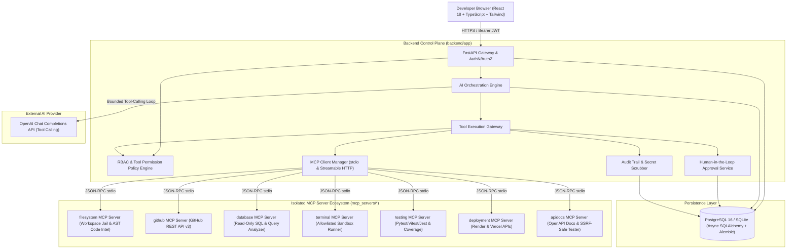
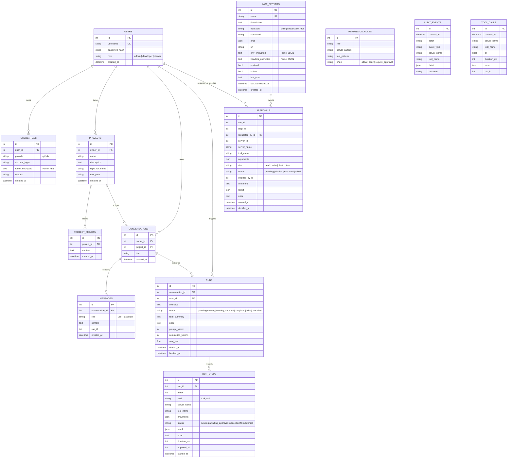
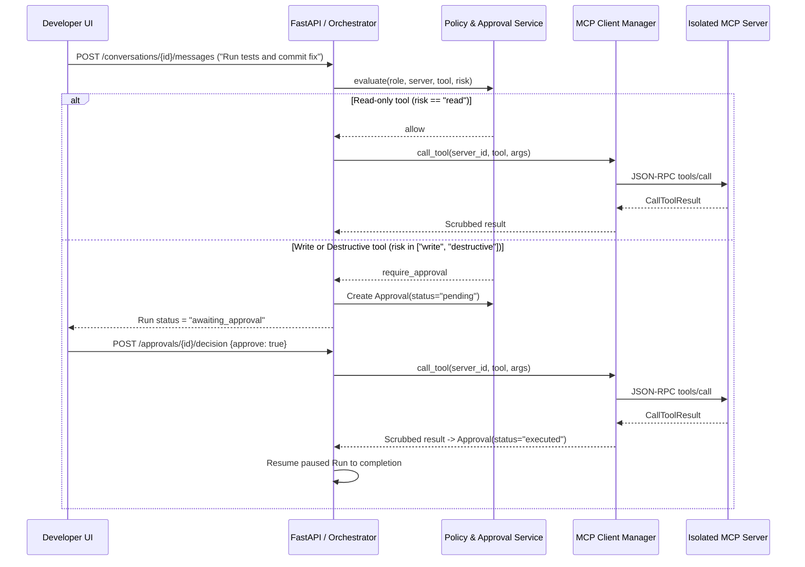

# DevPilot System Architecture & Database ER Diagram

## 1. Layered System Architecture

DevPilot enforces strict separation between the React presentation layer, the FastAPI control plane, the AI Orchestration Engine, the MCP Client Manager, and the 7 isolated MCP servers. The AI model never receives raw external API keys and cannot bypass the MCP tool gateway or human-in-the-loop approval service.

---

## 2. Database Entity-Relationship (ER) Diagram

---

## 3. Approval & Tool Execution Sequence

